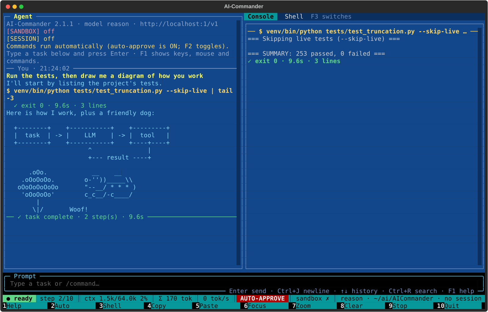

# AI-Commander

**PyPI package:** [`aic-agent`](https://pypi.org/project/aic-agent/) — install with `pip install aic-agent` (the command is `aic`).

AI-Commander is a **ralph-loop AI agent** that provides shell access and task
planning capabilities to Large Language Models through function calling. It
runs a tight agent loop: it plans, executes shell commands, observes the
results, and iterates until the requested task is complete — all while you stay
in control through an approval gate.

It supports two presentation modes:

- **Default (TUI)** — a [Textual](https://textual.textualize.io/)-based,
  Norton-Commander-style terminal UI: agent output and console/shell panes, a
  multi-line prompt, a status line and a function-key bar, with full mouse
  support (select to copy, right/middle-click to paste).
- **`--nogui`** — the original direct-CLI behaviour (stdout/stderr, no TUI).



---

## Table of Contents

- [Features](#features)
- [Requirements](#requirements)
- [Installation](#installation)
- [Usage](#usage)
- [Command-line options](#command-line-options)
- [How it works](#how-it-works)
- [The TUI](#the-tui)
  - [Layout](#layout)
  - [Slash commands](#slash-commands)
  - [Keyboard shortcuts](#keyboard-shortcuts)
  - [Mouse, copy and paste](#mouse-copy-and-paste)
  - [Prompt history](#prompt-history)
- [The approval gate](#the-approval-gate)
- [Context compression](#context-compression)
  - [How the budget works](#how-the-budget-works)
  - [The `truncate` algorithm](#the-truncate-algorithm)
  - [The `context-compressor-llm` algorithm](#the-context-compressor-llm-algorithm)
  - [Choosing an algorithm](#choosing-an-algorithm)
- [Session persistence](#session-persistence)
  - [The session file format](#the-session-file-format)
  - [Editing a session by hand](#editing-a-session-by-hand)
  - [Multiple instances in one directory](#multiple-instances-in-one-directory)
  - [Crash recovery semantics](#crash-recovery-semantics)
- [Sandboxing (Linux)](#sandboxing-linux)
- [Fast mode](#fast-mode)
- [Environment variables](#environment-variables)
- [Debugging](#debugging)
- [Project structure](#project-structure)
- [License](#license)

---

## Features

- **Ralph-loop agent** — repeatedly plans, executes, and observes until the
  task is done.
- **Shell access** — runs arbitrary commands and captures their output.
- **Web search** — using the duck-duck-go `ddgs` Python package (installed via requirements.txt).
- **Approval gate** — review each command before it runs, or auto-approve.
- **Command timeouts** — prevent runaway commands (configurable).
- **Output limits** — command output is capped and truncated with a sentinel so
  the model never receives unbounded text.
- **Context compression** — two pluggable algorithms keep the conversation
  history within the model's prompt budget.
- **OS-level sandbox** — optional [Landlock](https://landlock.io/) sandbox on
  Linux to restrict writes to the working directory, `/tmp`, `/dev`, and
  `/dev/pts`.
- **Two presentation modes** — full TUI or plain CLI (`--nogui`).
- **Mouse copy & paste** — drag to select text in any pane (copied
  automatically, re-joining soft-wrapped lines), double-click a word,
  triple-click a line, right/middle-click to paste.
- **Multi-line prompt with history** — Enter sends, Ctrl+J/Shift+Enter adds a
  line, Up/Down and Ctrl+R search persistent history; multi-line pastes stay
  intact.
- **Embedded shell** — a colored interactive shell tab with scrollback whose
  `cd` is followed by the agent.
- **Session persistence** — the complete conversation history is mirrored to a
  hand-editable JSON file (`.aicsession`) after every step and reloaded on every
  startup, so a crash or Ctrl+C loses nothing already produced.

---

## Requirements

- Python 3.9+
- An OpenAI-compatible API endpoint (any provider that exposes the
  `/chat/completions` interface).

---

## Installation

### From PyPI (or from source)

```bash
pip install aic-agent
```

This installs the `aic` command plus every runtime dependency, including the
Textual TUI and the `context-compressor-llm` context compressor, so both the
TUI and LLM-based compression work out of the box. (`py-landlock` is installed
only on Linux; elsewhere the agent simply runs unsandboxed.)

Upgrade with:

```bash
pip install --upgrade aic-agent
```

### From a checkout of this repository

```bash
git clone https://github.com/ortegaalfredo/AICommander
cd AICommander
python3 -m venv venv
source venv/bin/activate
pip install .
```

Or, to install in editable mode while hacking on the code:

```bash
pip install -e .
```

Alternatively, install only the dependencies and run the script directly:

```bash
pip install -r requirements.txt
python3 aic.py ...
```
> **Note:** The `py-landlock` package is only used on Linux and
> is optional — the agent runs unsandboxed if it is not installed.

---

## Usage

AI-Commander is a single-file script. Run it from the repository root with
`python3 aic.py`, or use the `aic` command installed by the
[`aic-agent`](https://pypi.org/project/aic-agent/) package:

```bash
# Installed via pip (package: aic-agent)
aic \
  --api-base https://api.example.com/v1 \
  --model your-model-name \
  --api-key YOUR_API_KEY \
  "your task request"

# From a repository checkout
python3 aic.py \
  --api-base https://api.example.com/v1 \
  --model your-model-name \
  --api-key YOUR_API_KEY \
  "your task request"
```

The TUI starts with no request and waits for you to type one in the prompt
panel. In `--nogui` mode a request is required on the command line.

### Command-line options

| Option | Description |
| ------ | ----------- |
| `--api-base` | API base URL (required). |
| `--model` | Model name (required). |
| `--api-key` | API key (required). |
| `--auto-approve` | Auto-approve command execution (for testing). |
| `--no-thinking` | Hide thinking tokens from output. |
| `--timeout` | Command timeout in seconds (default: `120`). |
| `--max-prompt-len` | Maximum prompt length in tokens (default: `80000`). |
| `--max-output-bytes` | Maximum output bytes returned from commands (default: `10240`). |
| `--max-steps` | Maximum number of agent loop steps before stopping (default: `500`). |
| `--debug` | Dump the full conversation history before every LLM call (see [Debugging](#debugging)). |
| `--nogui` | Run in direct CLI mode without TUI (original behaviour). No session file is read or written unless `--session` is given. |
| `--no-mouse` | TUI without mouse capture, leaving selection and paste to the terminal itself. |
| `--session` | Session file mirroring the conversation history (default: `./.aicsession`). |
| `--no-session` | Disable session persistence (nothing is written or loaded). |
| `--disable-sandbox` | Disable the OS-level Landlock sandbox (Linux only). |
| `--compress-alg` | Context-compression algorithm (`context-compressor-llm` or `truncate`). |
| `--compress-target` | Fraction of the prompt budget retained as headroom (default: `0.4`). |
| `--fast` | Fast mode: force `truncate` compression and a smaller system prompt, for slow inference systems. |
| `--reasoning-effort` | Reasoning effort for the LLM (e.g. `low`, `medium`, `high`). |
| `request` | The task request (positional, required in `--nogui` mode). |

### Example

```bash
# Run in the TUI (default)
python3 aic.py --api-base https://api.example.com/v1 \
  --model gpt-4o --api-key sk-... "List all files in this directory"

# Run in plain CLI mode
python3 aic.py --nogui --api-base https://api.example.com/v1 \
  --model gpt-4o --api-key sk-... "Summarize the contents of aic.py"

# Auto-approve all commands (useful for testing / scripting)
python3 aic.py --auto-approve --api-base https://api.example.com/v1 \
  --model gpt-4o --api-key sk-... "Set up a new Python project"

# Use the truncation algorithm and a smaller, faster prompt
python3 aic.py --fast --api-base https://api.example.com/v1 \
  --model gpt-4o --api-key sk-... "List all files"
```

---

## How it works

1. The agent receives your task request.
2. It plans the next step and may emit *thinking* tokens.
3. It proposes shell commands, which you approve or auto-approve.
4. Commands run (optionally sandboxed and time-limited), and their output is
   fed back to the model.
5. The loop repeats until the task is considered complete.

All I/O is routed through the `EventSink` abstraction, so the same agent logic
runs unchanged in both the TUI and `--nogui` modes.

The model's thinking (`reasoning_content`) is sent back with its turns for the
rest of the current task ("preserved thinking"), as interleaved-thinking models
such as GLM and DeepSeek expect; without it they see their earlier turns with
empty thinking and progressively stop thinking. It is cleared when you send a
new request, and if an endpoint refuses it, AI-Commander retries without it
and stops sending it for the session.

The agent exposes a single tool, `execute_bash(command)`, which runs the
command in a pseudo-terminal (PTY). The PTY gives the command a real terminal
environment (so interactive tools and `tput`-style programs work) and lets the
agent capture output, enforce a timeout, and kill the whole process group when
needed. Output is streamed live to the console panel and the final result is
truncated to `--max-output-bytes` with the literal sentinel
`output too long: truncated` appended when the limit is exceeded.

---

## The TUI

### Layout

The default Textual interface is a Norton-Commander-style split screen:

- **Left pane — Agent**: the model's streamed answer (live, word-wrapped and
  re-wrapped when the terminal is resized), its thinking in dim italics, each
  command it runs (`$ command`) with an exit/duration summary, and status
  messages. The pane title shows an LLM-generated summary of the task.
- **Right pane — Console / Shell**: two tabs (click them or press `F3`).
  *Console* shows every command the agent runs with its live output and exit
  code; *Shell* is an embedded, colored interactive shell with scrollback. When
  you `cd` in the shell, the agent's commands follow you there.
- **Prompt**: a multi-line input box (it grows with its content).
- **Status line**: what the agent is doing (thinking, writing, running a
  command, waiting for approval, retrying) with elapsed time, step count,
  context usage against the prompt budget, cumulative tokens, tokens/second,
  the approval mode, sandbox state, model, working directory and session file.
- **Function-key bar**: `1 Help · 2 Auto · 3 Shell · 4 Copy · 5 Paste ·
  6 Focus · 7 Zoom · 8 Clear · 9 Stop · 10 Quit`; the labels are clickable.

The agent runs in a background thread and communicates with the UI through a
queue; the UI never blocks on the agent. Typing while the agent works queues a
steering message that is delivered at its next step.

### Slash commands

Type any of the following in the prompt (Tab completes them). They are UI
controls, so they are **not** added to prompt history:

| Command | Aliases | Description |
| ------- | ------- | ----------- |
| `/help` | — | Show keys, mouse actions and commands (same as `F1`). |
| `/autoapprove` | `/aa` | Toggle auto-approve on/off (same as `F2`). When ON, commands run without asking. |
| `/clear` | `/new` | Clear the conversation history and start a fresh session (resets tokens, step count, and session id). The session file is emptied too, so nothing is resurrected on the next startup. A running agent is stopped first. |
| `/session` | — | Show the session file, session id, instance number, and what is currently saved on disk. |
| `/reload` | — | Re-read the session file, picking up edits made to its `messages` array outside AI-Commander (requires a stopped agent). |
| `/copy` | — | Copy the agent's last answer to the clipboard. |
| `/stop` | — | Stop the running agent (same as `F9`). |
| `/quit` | `/exit` | Stop the agent and exit the application. |
| `/approve`, `/reject`, `/suggest <text>` | — | Answer a pending approval (normally done in the approval dialog). |

### Keyboard shortcuts

| Key | Action |
| --- | ------ |
| `Enter` | Send the prompt. |
| `Ctrl+J` / `Shift+Enter` | Insert a new line in the prompt. |
| `Up` / `Ctrl+P`, `Down` / `Ctrl+N` | Previous / next prompt in history (when the cursor is on the first / last line). |
| `Ctrl+R` | Reverse incremental search over prompt history. |
| `Tab` | Complete a `/command`; otherwise move to the next pane. |
| `F1` | Help. |
| `F2` | Toggle auto-approve. |
| `F3` | Switch the right pane between Console and Shell. |
| `F4` / `F5` | Copy (the selection, or the last answer) / paste. |
| `F6` | Move the focus to the next pane (also the way out of the Shell). |
| `F7` | Zoom the focused pane to full screen; `Escape` restores it. |
| `F8` (twice) | Clear the conversation. |
| `F9` | Stop the agent (a pending LLM response is cut off immediately). |
| `Ctrl+C` | Copy the selection; otherwise stop a running agent; press twice while idle to quit. |
| `F10` / `Ctrl+Q` | Quit (the session and history are saved). |
| `Y` / `N` / `A` | In the approval dialog: approve / reject / always approve. |

While the **Shell** tab has the focus, every key except the function keys goes
to the shell (so `Ctrl+C`, `Escape`, `Tab` and arrows work as in a terminal);
use `F6` or the mouse to leave it.

### Mouse, copy and paste

- **Select** text by dragging in any pane: the selection is copied to the
  clipboard as soon as you release the button (a notice confirms it). Lines
  that were only wrapped to fit the pane are copied as the original single
  line. Double-click selects a word (paths and URLs included), triple-click a
  whole line.
- **Right-click** copies the selection of the pane you click; with no
  selection it pastes. **Middle-click** pastes. Pasting into an output pane
  goes to the prompt; pasting into the shell honours bracketed-paste mode.
- **Keyboard**: `Ctrl+C` copies a selection, `Ctrl+V` pastes in the prompt,
  `F4` copies the selection or the last answer, `F5` pastes. Your terminal's
  own paste (e.g. `Ctrl+Shift+V`) works too, including multi-line text.
- Copies go to the desktop clipboard: on X11 (and Wayland desktops with
  Xwayland, such as GNOME) AI-Commander sets it directly through `libX11`, so
  no extra tools are needed — the text stays available after AI-Commander exits,
  until something else is copied, and middle-click pastes it in other apps too.
  `wl-copy`, `xclip`, `xsel`, `pbcopy` or `clip.exe` are used when installed,
  and OSC 52 covers terminals that support it (also over SSH and in tmux).
  Mouse pastes read the desktop clipboard the same way, falling back to
  AI-Commander's own clipboard.
- The mouse wheel scrolls every pane, including the shell's scrollback
  (`Shift+PgUp` / `Shift+PgDn` too). Start with `--no-mouse` to leave the
  mouse entirely to your terminal.

### Prompt history

Prompt history is persisted to `~/.aic_history` (up to 1000 entries, one per
line with newlines escaped, so multi-line prompts survive) and loaded at
startup. The file is opened before the Landlock sandbox is applied, so new
prompts are saved even though the sandbox blocks other writes to `$HOME`.
Up/Down navigation preserves your in-progress text, and `Ctrl+R` opens a
reverse search that filters history newest-first; `Ctrl+R` cycles to the next
older match, `Enter` accepts a match back into the prompt, and
`Escape`/`Ctrl+G` cancels.

---

## The approval gate

By default every command the agent proposes must be approved before it runs.
This keeps you in control of what executes on your system. The TUI shows the
command (syntax highlighted) in a dialog:

- **Yes** (`Y`) — the command runs.
- **No** (`N`, `Escape`) — the command is skipped and the agent is told it was
  skipped.
- **Always** (`A`) — the command runs and auto-approve is switched on.
- **Suggestion** — type text in the dialog's input and press `Enter`: the
  command is skipped and your suggestion is fed back to the agent as a user
  message steering it.

For a moment after the dialog opens its keys are ignored, so typing that was
meant for the prompt can never approve a command by accident. In `--nogui`
mode the same choices are asked on the terminal; a blank answer, end of input
or `Ctrl+C` never approves.

You can toggle auto-approve at any time with `F2` or `/autoapprove` (`/aa`), or
start with `--auto-approve`. When auto-approve is ON, all commands run without
asking (the status line shows **AUTO-APPROVE**) — useful for testing and
scripting, but be ready to stop the agent (`F9`) if a command misbehaves.

---

## Context compression

Long agent sessions accumulate conversation history. When the estimated token
count of the history exceeds the prompt budget, AI-Commander compresses it so
the request fits inside the model's context window. Compression is triggered
automatically at the start of each agent step and is a no-op when the history
is under budget.

### How the budget works

The prompt budget is `--max-prompt-len` (default 80,000 tokens). For models
that accept a `max_tokens` request parameter (all non-`gpt` models), the budget
is reduced by the output reservation (`max_tokens`, 16,000) so the prompt leaves
room for the completion inside the context window:

```
prompt_budget = max_prompt_len - max_tokens   (for non-gpt models)
prompt_budget = max_prompt_len                (for gpt models)
```

Token counts are estimated locally with a conservative heuristic (~3 characters
per token plus per-message overhead). Exact numbers come from the API's usage
stats once each call finishes and are shown in the status bar. If the server
still rejects a prompt as too long (tokenizers differ, e.g. for CJK text), the
history is compressed harder and the request retried.

### The `truncate` algorithm

`--compress-alg truncate` (or `--fast`) is the simpler, cheaper algorithm. It
always preserves the **system prompt**, the **first user instruction** and the
**request that started the current run**, so the agent never forgets either its
primary objective or what it is working on now. It works in two passes:

1. **Condense oversized tool outputs** in place (oldest first), replacing
   verbose command results with `<condensed tool output>`.
2. **Drop the oldest other messages** if condensation alone isn't enough.

Both passes stop once the retained history fits within
`--compress-target` (default 40%) of the budget, leaving headroom so several
new turns fit before the next compression. Truncating down to the *full*
budget would make every following prompt exceed the limit again and re-compress
on each step, slowly losing more history than necessary.

### The `context-compressor-llm` algorithm

`--compress-alg context-compressor-llm` (the default) uses the
[`context-compressor-llm`](https://pypi.org/project/context-compressor-llm/)
package, which implements a Factory.ai-style **anchored-summary incremental
compressor**. When the non-system log exceeds the budget it:

1. **Evicts the oldest prefix** of the conversation.
2. **Folds it into a persistent `AnchoredSummary`** via an LLM call on the
   evicted segment only (so the summarizer call stays short on slow-prefill
   systems).
3. **Retains the newest suffix** — an append-only, KV-cache-friendly layout.

The system prompt is kept **byte-identical** at the front of the retained
context so unchanged prefixes are never re-prefilled (important on systems with
slow prompt processing / prefix caching); the summary is appended to it after a
`[Prior conversation summary]` marker. Each new compression folds the previous
summary into the new one, so summaries never pile up, and only the summary
itself is kept (not the model's `<analysis>` scratchpad). The first user
instruction and the current request are preserved verbatim, and a fallback user
message is appended if aggressive compression would leave no user query at all
(some endpoints reject that). When nothing can be summarized, the `truncate`
algorithm is applied instead.

If the `context-compressor-llm` package is not installed, this algorithm falls
back to `truncate`.

### Choosing an algorithm

| Algorithm | Cost | Context quality | Best for |
| --------- | ---- | --------------- | -------- |
| `truncate` | Cheap (no extra LLM calls) | Loses detail from old tool outputs and messages | Fast local inference, short tasks, `--fast` mode |
| `context-compressor-llm` | One LLM summarizer call per compression | Preserves a running summary of evicted history | Long tasks, slow-prefill systems, KV-cache-friendly setups |

Use `--compress-target` to control how much headroom is retained (default
`0.4` = 40%). A higher value keeps more history but triggers compression sooner;
a lower value compresses harder but loses more context.

---

## Session persistence

AI-Commander mirrors the **complete conversation history** to a JSON file and
reloads it on every startup, so nothing already produced is lost to a crash, a
`kill`, a closed terminal, or `Ctrl+C`.

- **Where** — `.aicsession` in the current working directory by default;
  override with `--session <path>` or turn persistence off with
  `--no-session`. Because the file lives in the working directory, it stays
  writable inside the Landlock sandbox.
- **When it is written** — after the user request, before every LLM call, right
  after each assistant turn, after every tool result, and again on exit
  (`atexit` plus `SIGTERM`/`SIGHUP` handlers). Writes are atomic
  (temp file → `fsync` → `os.replace`), so the file is never half-written.
- **What is reloaded** — the message history verbatim, plus the session id,
  step count, and cumulative token usage. `--nogui` resumes the conversation
  where the previous run stopped; the TUI restores history at startup and shows
  the session file in the status bar.
- **A corrupt file is never destroyed** — unparseable JSON is moved to
  `.aicsession.corrupt.<timestamp>` and the run starts clean.

The status line at startup reports what happened, e.g.
`[SESSION] Persisting session to /project/.aicsession` or
`[SESSION] Restored 14 message(s) from .aicsession (session 20260828_134851, step 4)`.

### The session file format

Plain, indented, UTF-8 JSON — deliberately simple enough to read and edit:

```json
{
  "aic_session_version": 1,
  "session_id": "20260828_134851",
  "updated_at": "2026-08-28T13:52:58",
  "reason": "tool_result",
  "model": "gpt-4o",
  "api_base": "https://api.example.com/v1",
  "cwd": "/home/me/project",
  "instance_number": 1,
  "step_count": 4,
  "usage": {
    "input_tokens": 5321,
    "output_tokens": 812,
    "cached_tokens": 4096,
    "billable_tokens": 2037
  },
  "messages": [
    { "role": "system", "content": "You are an expert planning..." },
    { "role": "user", "content": "summarize this repo" },
    { "role": "assistant", "content": null, "tool_calls": [
      { "id": "call_1", "type": "function",
        "function": { "name": "execute_bash",
                      "arguments": "{\"command\": \"ls\"}" } } ] },
    { "role": "tool", "tool_call_id": "call_1", "content": "aic.py\nREADME.md" }
  ]
}
```

`messages` is the raw OpenAI message list, saved **exactly** as the agent holds
it (same roles, `tool_calls`, and `tool_call_id`s). `reason` records which
checkpoint produced the file (`user_request`, `before_llm_call`,
`assistant_message`, `tool_result`, `loop_terminated`, `process_exit`,
`signal_15`, `interrupted`, `cleared`, …), which makes it easy to tell where a
crashed run stopped.

### Editing a session by hand

Because the `messages` array is stored verbatim, a session can be reshaped with
any text editor or JSON tool:

```bash
# drop the last 6 turns, then resume
python3 - <<'EOF'
import json
d = json.load(open(".aicsession"))
d["messages"] = d["messages"][:-6]
json.dump(d, open(".aicsession", "w"), indent=2)
EOF
python3 aic.py --api-base ... "continue from here"
```

- Change, insert, or delete turns; edits are picked up on the next startup, or
  immediately inside the TUI with `/reload`.
- A **bare JSON array** of messages is accepted in place of the full object, so
  you can paste a transcript straight into the file.
- Invalid content is repaired rather than rejected: a missing system prompt is
  prepended, orphan `tool` messages and empty assistant turns are dropped, and
  consecutive assistant turns are merged (keeping the text and tool calls of
  both). A trailing assistant answer is kept — it is the previous run's final
  reply. Each repair is reported so nothing changes silently.
- If the file ended on an assistant turn that **did** issue tool calls (the
  process died mid-command), the tool calls are answered with a
  `[SESSION RECOVERED]` notice stating the command was **not** re-executed — the
  agent is told not to assume it had any effect, rather than replaying it.

### Multiple instances in one directory

Each process claims its session file with an `flock` on a sidecar
`.aicsession.lock` (the data file itself is atomically replaced, so the lock
lives beside it). Launching a second AI-Commander in the same directory warns
and shifts to a numbered file instead of clobbering the first:

```
[SESSION] WARNING: another AI-Commander instance is already using .aicsession
          in this directory; this instance uses .aicsession2 instead (instance 2)
```

Third instance → `.aicsession3`, and so on. The lock is released by the kernel
when a process exits or dies, so a crashed run can never permanently squatter a
name. `--session <path>` participates in the same numbering
(`<path>2`, `<path>3`, …).

### Crash recovery semantics

| Failure | What the file holds | On restart |
| ------- | ------------------- | ---------- |
| `Ctrl+C` / unhandled exception | History through the last completed step, re-saved in `finally` | Resumed verbatim |
| `kill` / terminal closed | Same, via the `SIGTERM`/`SIGHUP` handlers | Resumed verbatim |
| `kill -9` / power loss / segfault | Everything up to the last completed assistant turn or tool result | Resumed; an in-flight tool call is closed with a "not re-executed" notice |
| Hand-broken JSON | Previous good file kept, bad copy saved as `.corrupt.*` | Starts clean |

At most the single in-flight turn — never earlier history — can be missing, and
the only thing never replayed automatically is a shell command that had not
finished when the process died.

---

## Sandboxing (Linux)

By default, on Linux, the agent attempts to enable an OS-level
[Landlock](https://landlock.io/) sandbox using `py-landlock`. When active,
writes are restricted to the current working directory, `/tmp`, `/dev`, and
`/dev/pts`. The status is shown in the agent output panel (green when active,
red when unsandboxed).

### What the sandbox restricts

- **Writes** are limited to the current working directory (recursively),
  `/tmp`, `/dev`, and `/dev/pts`.
- **Reads and execution** are allowed anywhere.
- **Network access** is preserved (so `curl`, `wget`, and the OpenAI client
  still work).
- `/dev` and `/dev/pts` (plus the `IOCTL_DEV` right, Landlock ABI v5) are
  required for PTY allocation.

The sandbox is applied **before** the agent thread starts, so the Landlock
domain covers the whole process — including every command the agent runs.

### Enabling / disabling

- The sandbox is attempted automatically on Linux unless `--disable-sandbox`
  is given.
- If `py-landlock` is not installed, the agent simply runs unsandboxed.
- The sandbox is **best-effort** (`strict=False`): on older kernels or unusual
  configurations it degrades gracefully rather than failing hard.

### When it is not applied

The sandbox is only applied on Linux. On other platforms (macOS, Windows) the
agent runs unsandboxed and reports that status at startup.

> **Tip:** The status bar and the startup banner show whether the sandbox is
> active. If you see `[red]Sandbox: off[/red]`, either you passed
> `--disable-sandbox`, `py-landlock` is missing, or you are not on Linux.

---

## Fast mode

`--fast` is designed for local inference and low-latency setups. It:

- Forces the `truncate` context-compression algorithm (no extra LLM
  summarizer calls).
- Uses a smaller, faster system prompt that drops the verbose persistence
  policy, internet-access recipe, PTY notes, and "think carefully" guidance.

This reduces prompt size and latency at the cost of less-detailed operating
instructions for the model.

---

## Environment variables

| Variable | Effect |
| -------- | ------ |
| `AIC_TEMPERATURE_TOOL` | Sampling temperature for agent turns (default `0.7`). |
| `AIC_TEMPERATURE_TEXT` | Temperature for internal text-only calls such as summaries (default `1.0`). |
| `AIC_STREAM_OPTIONS=0` | Do not send `stream_options` (usage reporting) to the endpoint. |
| `AIC_EXTRA_BODY=0` | Do not send `chat_template_kwargs.enable_thinking` to the endpoint. |
| `AIC_DEBUG_DUMP_DIR` | Directory for `--debug` dumps (default `~/.aic`). |
| `NO_COLOR` | Disable colors in `--nogui` mode (they are also off when output is piped). |

Endpoints that reject `stream_options` or `extra_body` are detected and the
request is retried without them automatically; the variables just skip the
first attempt.

Agent commands run with `PAGER=cat` and `GIT_PAGER=cat` (a pager would wait for
a keypress forever), and the output returned to the model has escape codes
removed and progress-bar redraws collapsed to their final state.

---

## Debugging

- `--debug` dumps the full conversation history before every LLM call to
  `~/.aic/commander-debug-<session>-<timestamp>.txt` (or `AIC_DEBUG_DUMP_DIR`;
  next to the session file, or `/tmp`, when the sandbox forbids `~/.aic`),
  including per-message roles, tool calls, and estimated token counts. Useful
  for diagnosing context-compression or prompt-format issues. With `--debug`,
  a crash of the agent thread also shows its traceback in the agent pane.
- The status bar shows a live estimate of the current context window and the
  cumulative session token total (excluding prompt-cached tokens, which are
  typically not billed).
- The `tests/` directory contains a test suite for truncation, sessions, the
  agent loop and the TUI (driven headless with a fake LLM client). Run it with
  `python3 tests/test_truncation.py --skip-live`.

---

## Project structure

```
├── aic.py            # The entire agent (single-file implementation)
├── requirements.txt  # Python dependencies
├── README.md         # This file
├── changelog.txt     # Release notes, newest first
├── tests/            # Test suite (truncation + core helpers)
└── LICENSE           # Apache 2.0
```

---

## License

This project is licensed under the [Apache License 2.0](LICENSE).
